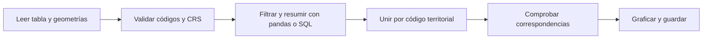
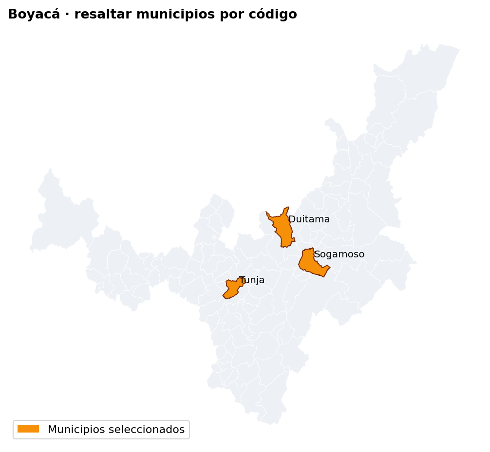
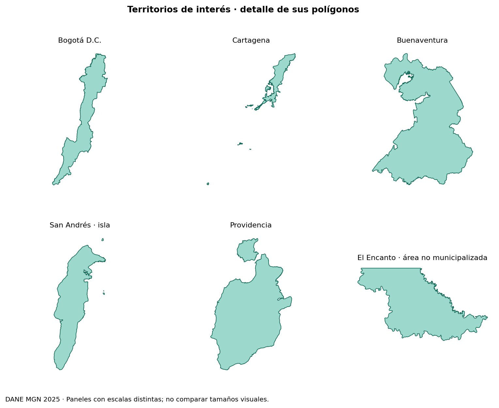
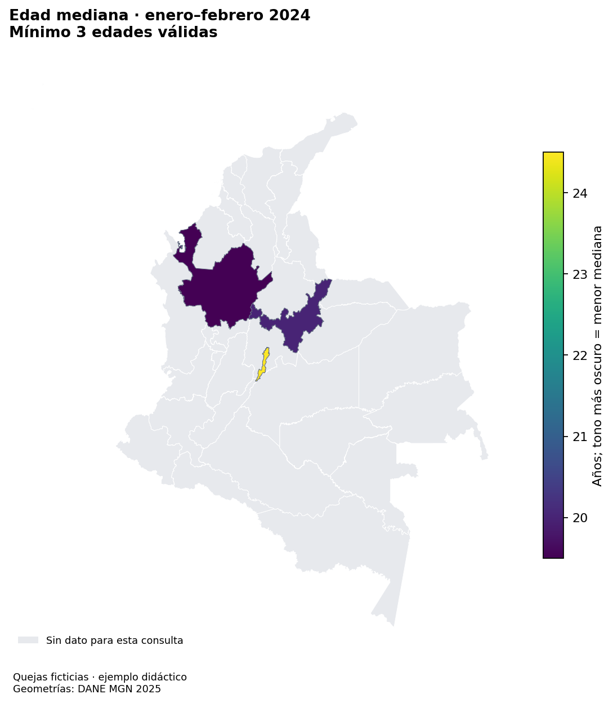

# Guía práctica de GeoPandas con mapas de Colombia

Operaciones básicas, selección de territorios y consultas tabulares representadas en mapas. Se usan límites del DANE y una tabla pequeña de **quejas ficticias** para aprender; al final se muestra cómo aplicar el flujo a los CSV de Supersalud. Cada ejemplo explica qué aporta GeoPandas frente a pandas.

> **Lectura relacionada:** [pandas](manual-pandas.md) · [Polars](manual-polars.md) · [DuckDB](manual-duckdb.md) · [Entornos virtuales](entornos-virtuales.md).

| Símbolo | Significado |
|:---:|---|
| 📘 | Concepto necesario para entender la operación. |
| ✅ | Control para comprobar el resultado. |
| ⚠️ | Error frecuente o límite de interpretación. |



> **📘 Idea central:** una tabla responde cuánto, cuándo y a quién corresponde un registro; la geometría permite mostrar dónde. Primero se consulta y resume; después se une el resultado con los polígonos. Contar registros de quejas no equivale a contar personas distintas, medir incidencia ni estimar calidad de atención.

## Contenido

1. [Preparación y archivos](#1-preparación-y-archivos)
2. [Leer departamentos y municipios](#2-leer-departamentos-y-municipios)
3. [Inspeccionar geometrías y sistemas de coordenadas](#3-inspeccionar-geometrías-y-sistemas-de-coordenadas)
4. [Graficar Colombia y ciudades de referencia](#4-graficar-colombia-y-ciudades-de-referencia)
5. [Resaltar municipios y territorios especiales](#5-resaltar-municipios-y-territorios-especiales)
6. [Preparar una tabla pequeña de quejas](#6-preparar-una-tabla-pequeña-de-quejas)
7. [Pasar de una consulta tabular a un mapa](#7-pasar-de-una-consulta-tabular-a-un-mapa)
8. [Departamentos con más quejas en algunos meses](#8-departamentos-con-más-quejas-en-algunos-meses)
9. [Quejas asociadas a personas más jóvenes](#9-quejas-asociadas-a-personas-más-jóvenes)
10. [Cambios mensuales y consultas municipales](#10-cambios-mensuales-y-consultas-municipales)
11. [Operaciones espaciales básicas](#11-operaciones-espaciales-básicas)
12. [Aplicar las consultas a los CSV reales](#12-aplicar-las-consultas-a-los-csv-reales)
13. [Guardar resultados y resolver errores frecuentes](#13-guardar-resultados-y-resolver-errores-frecuentes)
14. [Resumen y referencias](#14-resumen-y-referencias)

## 1. Preparación y archivos

Usar el entorno **CPU** del curso: GeoPandas **1.1.1**, pandas **2.2.3**, Matplotlib **3.10.3** y Pyogrio **0.11.1**. Desde la raíz del repositorio y con `.venv` activo:

```bash
python -m pip install -r kit/requirements.txt
python -m pip check
```

No se necesita GPU, un servidor de mapas ni servicios de geocodificación. Ejecutar los bloques Python en orden; los ejemplos comparten variables. Las instalaciones [Windows/WSL](instalacion-wsl.md) y [Linux/macOS](instalacion-linux-macos.md) preparan estas bibliotecas.

| Archivo | Uso |
|---|---|
| `kit/data/raw/dane_departamentos.zip` | MGN DANE 2025, nivel departamental. |
| `kit/data/raw/dane_municipios.zip` | MGN DANE 2025, nivel municipal y entidades del mismo nivel geográfico. |
| `kit/data/pqrs_muestras/Muestra_1000_2024_I.csv` | Solo sección 12: adaptación a una muestra real. |

Si faltan los ZIP, seguir la [descarga manual de cartografía DANE](entorno.md#descarga-manual-de-los-shapes-dane). Los originales no están incluidos en Git. Se pueden leer comprimidos; no separar los componentes SHP, SHX, DBF y PRJ. Los enlaces y cortes están en el [catálogo de fuentes](datasets.md).

```python
from pathlib import Path
import pandas as pd
import geopandas as gpd
import matplotlib.pyplot as plt
from matplotlib.patches import Patch

actual = Path.cwd().resolve()
REPO = next((p for p in [actual, *actual.parents]
             if (p / "kit/fuentes.json").is_file()), None)
if REPO is None:
    raise FileNotFoundError("Abrir Python dentro del repositorio del curso")
RAW = REPO / "kit/data/raw"
SALIDAS = REPO / "kit/salidas/manual_geopandas"
SALIDAS.mkdir(parents=True, exist_ok=True)
for nombre in ["dane_departamentos.zip", "dane_municipios.zip"]:
    if not (RAW / nombre).is_file():
        raise FileNotFoundError(f"Falta {RAW / nombre}; consultar la descarga DANE")

plt.rcParams.update({"font.size": 10, "figure.facecolor": "white"})

def guardar_figura(fig, nombre):
    fig.savefig(SALIDAS / nombre, dpi=160, bbox_inches="tight", facecolor="white")
    plt.show()
    plt.close(fig)
```

> **Frente a pandas:** un `GeoDataFrame` conserva filtros, `groupby` y `merge`, y añade una columna geométrica activa, CRS y operaciones espaciales. No hace falta reemplazar pandas para calcular los indicadores.

## 2. Leer departamentos y municipios

### Qué es una geometría

Una **geometría** describe la forma y la ubicación de un objeto mediante coordenadas. En GeoPandas se guarda normalmente en la columna `geometry`, junto a los atributos de la fila, como nombre, código o número de quejas.

| Geometría | Qué representa | Ejemplo |
|---|---|---|
| `Point` | Una ubicación. | Un punto de referencia en Tunja. |
| `LineString` | Una línea formada por varios puntos. | El trazado de una carretera o un río. |
| `Polygon` | Una superficie delimitada, que puede tener huecos. | El territorio de un municipio. |
| `MultiPolygon` | Varias superficies separadas pertenecientes al mismo objeto. | Una unidad territorial con islas. |

> **📘 Por qué importa:** el nombre «Tunja» permite buscar una fila; su polígono permite dibujar el territorio, medir su área o decidir si un punto está dentro. Una geometría vacía o inválida puede impedir esas operaciones o alterar sus resultados. Un punto que representa una ciudad no sustituye su extensión territorial.

### Leer las capas

```python
deptos = gpd.read_file(f"zip://{RAW / 'dane_departamentos.zip'}", engine="pyogrio")
municipios = gpd.read_file(f"zip://{RAW / 'dane_municipios.zip'}", engine="pyogrio")
print(deptos.columns.tolist())
print(municipios.columns.tolist())

# Nombres del corte MGN usado en el curso: comprobarlos antes de renombrar.
deptos = deptos.rename(columns={"dpto_ccdgo": "cod_depto", "dpto_cnmbr": "departamento"})
municipios = municipios.rename(columns={
    "dpto_ccdgo": "cod_depto", "mpio_cdpmp": "cod_mpio",
    "mpio_cnmbr": "municipio", "mpio_tipo": "tipo_territorio",
})

def codigo_texto(serie, ancho):
    texto = serie.astype("string").str.strip()
    valido = texto.str.fullmatch(r"[0-9]{1," + str(ancho) + r"}", na=False)
    return texto.where(valido).str.zfill(ancho)

deptos["cod_depto"] = codigo_texto(deptos["cod_depto"], 2)
municipios["cod_depto"] = codigo_texto(municipios["cod_depto"], 2)
municipios["cod_mpio"] = codigo_texto(municipios["cod_mpio"], 5)
assert deptos["cod_depto"].notna().all() and deptos["cod_depto"].is_unique
assert municipios["cod_mpio"].notna().all() and municipios["cod_mpio"].is_unique
print("Unidades departamentales:", len(deptos), "Unidades municipales:", len(municipios))
```

> **✅ Corte del curso:** 33 unidades en la capa departamental, porque incluye Bogotá D.C. separadamente, y 1.122 unidades en la municipal. No llamar «33 departamentos» al resultado. Revisar nuevamente si se utiliza otro corte.

> **⚠️ Clave:** `mpio_cdpmp` tiene cinco dígitos; `mpio_ccdgo` contiene solo los tres dígitos locales y se repite entre departamentos. Unir por código completo, no por nombre. Un código válido en formato todavía puede no existir en la cartografía.

| Necesidad | pandas | GeoPandas |
|---|---|---|
| Leer CSV | `pd.read_csv` | Leer con pandas y unir después. |
| Leer GeoJSON, SHP o GeoPackage | Sin lector espacial propio | `gpd.read_file` |
| Seleccionar filas | `.loc`, `.query` | Los mismos métodos. |
| Conservar geometría | Columna ordinaria sin operaciones GIS | Columna `geometry` y CRS asociados. |

## 3. Inspeccionar geometrías y sistemas de coordenadas

### Qué son el CRS y una proyección

El **sistema de referencia de coordenadas (CRS)** indica cómo interpretar las coordenadas: su referencia sobre la Tierra, sus ejes y sus unidades. Sin él, dos números no bastan para saber dónde está un punto. Un código EPSG identifica una definición concreta de CRS.

Una **proyección cartográfica** transforma posiciones de la superficie curva de la Tierra a un plano. Un CRS geográfico, como EPSG:4326, utiliza longitud y latitud en grados; un CRS proyectado utiliza coordenadas planas, frecuentemente en metros. CRS y proyección están relacionados, pero no son sinónimos.

> **📘 Por qué importa:** para superponer capas o realizar una operación espacial entre ellas, llevarlas a un CRS común. Para medir, elegir además uno adecuado a la región y al objetivo: toda proyección introduce distorsiones en alguna propiedad, como áreas, distancias o formas. Un CRS en metros no garantiza exactitud en cualquier lugar.

Por ejemplo, `buffer(1000)` en un CRS expresado en metros crea una zona de 1.000 metros en ese plano; en EPSG:4326 usaría 1.000 grados, no un kilómetro. `set_crs` declara cómo leer las coordenadas existentes; `to_crs` calcula nuevas coordenadas para representar la misma ubicación en otro sistema.

### Comprobar antes de medir

```python
for nombre, capa in [("departamentos", deptos), ("municipios", municipios)]:
    print(nombre, capa.crs, capa.geom_type.value_counts().to_dict())
    assert capa.crs is not None, "Consultar el CRS de la fuente; no adivinarlo"
    assert capa.geometry.notna().all() and (~capa.geometry.is_empty).all()
    assert capa.is_valid.all(), "Revisar geometrías antes de operar"

# Representación geográfica para los mapas de contexto.
deptos = deptos.to_crs(4326)
municipios = municipios.to_crs(4326)

# Mediciones en metros para un ejemplo regional de Boyacá.
boyaca = municipios.loc[municipios["cod_depto"] == "15"].copy()
boyaca_m = boyaca.to_crs(9377)
boyaca_m["area_km2"] = boyaca_m.area / 1_000_000
print(boyaca_m[["municipio", "area_km2"]].head())
```

| Operación | Significado |
|---|---|
| `.crs` | Sistema de coordenadas declarado. |
| `.set_crs(...)` | Asignar la referencia conocida; no modifica coordenadas. |
| `.to_crs(...)` | Transformar coordenadas a otra referencia. |
| `.is_valid`, `.is_empty` | Revisar validez y geometrías vacías. |
| `.area`, `.length`, `.distance` | Medir en las unidades del CRS. |

> **⚠️ Proyección:** EPSG:4326 expresa longitud/latitud en grados; no calcular áreas o buffers métricos allí. EPSG:9377 se usa aquí para el ejemplo continental de Boyacá; elegir un CRS adecuado al territorio y a la medición. No usar `set_crs` para «mover» una capa mal alineada. [Proyecciones en GeoPandas](https://geopandas.org/en/v1.1.1/docs/user_guide/projections.html).

> **Ventaja frente a pandas:** GeoPandas conoce las geometrías y transforma sus coordenadas. pandas sigue siendo útil para ordenar la columna `area_km2` una vez calculada.

## 4. Graficar Colombia y ciudades de referencia

### Mapa general con departamentos

```python
fig, ax = plt.subplots(figsize=(9, 9))
deptos.plot(ax=ax, color="#edf1f5", edgecolor="#667085", linewidth=0.45)
ax.set_title("Colombia · unidades departamentales del MGN 2025", loc="left", weight="bold")
ax.set_axis_off()
fig.text(0.13, 0.06, "Fuente: DANE, MGN 2025. Incluye Bogotá D.C. y territorios insulares.", fontsize=8)
guardar_figura(fig, "01_colombia.png")
```

`.plot()` representa los polígonos; en pandas `.plot()` sobre una columna numérica normalmente produce un gráfico estadístico. Las islas pueden verse pequeñas en la extensión nacional: se amplían en la sección 5 y nunca se presentan como si no existieran.

### Ciudades sobre el mapa

Los siguientes puntos son **referencias aproximadas didácticas** de centros urbanos, no ubicaciones de quejas ni límites urbanos oficiales. Longitud va en `x` y latitud en `y`.

```python
ciudades_tabla = pd.DataFrame({
    "ciudad": ["Bogotá", "Medellín", "Cali", "Barranquilla", "Tunja"],
    "lon": [-74.0721, -75.5812, -76.5320, -74.7813, -73.3678],
    "lat": [4.7110, 6.2442, 3.4516, 10.9685, 5.5353],
})
ciudades = gpd.GeoDataFrame(
    ciudades_tabla,
    geometry=gpd.points_from_xy(ciudades_tabla["lon"], ciudades_tabla["lat"]),
    crs=4326,
)
fig, ax = plt.subplots(figsize=(9, 9))
deptos.plot(ax=ax, color="#edf1f5", edgecolor="white", linewidth=0.5)
ciudades.plot(ax=ax, color="#d92d20", markersize=25, zorder=3)
for fila in ciudades.itertuples():
    ax.annotate(fila.ciudad, (fila.geometry.x, fila.geometry.y),
                xytext=(5, 5), textcoords="offset points", fontsize=9)
ax.set_title("Ciudades de referencia sobre Colombia", loc="left", weight="bold")
ax.set_axis_off()
fig.text(0.13, 0.06, "DANE MGN 2025 · Puntos urbanos aproximados para enseñanza", fontsize=8)
guardar_figura(fig, "02_ciudades.png")
```

> **Ventaja frente a pandas:** `points_from_xy` convierte coordenadas tabulares en geometrías que se pueden graficar y consultar espacialmente. Las coordenadas deben provenir de una fuente conocida en un trabajo real.

## 5. Resaltar municipios y territorios especiales

### Tunja, Duitama y Sogamoso sobre Boyacá

```python
codigos_elegidos = ["15001", "15238", "15759"]
elegidos = boyaca.loc[boyaca["cod_mpio"].isin(codigos_elegidos)].copy()
assert set(elegidos["cod_mpio"]) == set(codigos_elegidos)
fig, ax = plt.subplots(figsize=(9, 7))
boyaca.plot(ax=ax, color="#edf1f5", edgecolor="white", linewidth=0.35)
elegidos.plot(ax=ax, color="#f79009", edgecolor="#7a2e0e", linewidth=0.8)
for fila in elegidos.itertuples():
    punto = fila.geometry.representative_point()
    ax.annotate(fila.municipio.title(), (punto.x, punto.y),
                xytext=(5, 5), textcoords="offset points", fontsize=9)
ax.legend(handles=[Patch(facecolor="#f79009", label="Municipios seleccionados")], loc="lower left")
ax.set_title("Boyacá · resaltar municipios por código", loc="left", weight="bold")
ax.set_axis_off()
guardar_figura(fig, "03_municipios_resaltados.png")
```

Para mostrar la selección sobre todo el país, sustituir `boyaca.plot(...)` por `deptos.plot(...)`. Los municipios pequeños perderán detalle; la vista regional permite verlos mejor. `representative_point()` elige un punto interior para la etiqueta, **no la cabecera municipal**.



### Bogotá, distritos, islas y áreas no municipalizadas

«Municipios especiales» no se usa aquí como una categoría legal única. Se distinguen ejemplos de interés: Bogotá D.C.; Cartagena y Buenaventura; San Andrés y Providencia; y El Encanto, un área no municipalizada. No inferir el régimen jurídico actual exclusivamente a partir de `mpio_tipo`: este corte rotula Bogotá y varios distritos como `MUNICIPIO`.

```python
casos = {
    "Bogotá D.C.": ["11001"],
    "Cartagena": ["13001"],
    "Buenaventura": ["76109"],
    "San Andrés · isla": ["88001"],
    "Providencia": ["88564"],
    "El Encanto · área no municipalizada": ["91263"],
}
fig, axes = plt.subplots(2, 3, figsize=(12, 8))
for ax, (titulo, codigos) in zip(axes.flat, casos.items()):
    sub = municipios.loc[municipios["cod_mpio"].isin(codigos)]
    assert len(sub) == len(codigos)
    sub.plot(ax=ax, color="#9dd8cc", edgecolor="#176b5b", linewidth=0.8)
    ax.set_title(titulo, fontsize=10)
    ax.set_axis_off()
fig.suptitle("Territorios de interés · detalle de sus polígonos", weight="bold")
fig.text(0.12, 0.03, "DANE MGN 2025 · Paneles con escalas distintas; no comparar tamaños visuales.", fontsize=9)
fig.subplots_adjust(hspace=0.28, bottom=0.09)
guardar_figura(fig, "04_territorios_especiales.png")
print(municipios.loc[municipios["cod_mpio"].isin(["88001", "88564", "91263"]),
                     ["cod_mpio", "municipio", "tipo_territorio"]])
```



> **⚠️ Ciudad y municipio:** el polígono municipal puede incluir extensas zonas rurales. Para representar una cabecera se necesita una capa de cabeceras; un punto urbano, un municipio y un distrito no son objetos intercambiables. [Clasificación DIVIPOLA del DANE](https://www.dane.gov.co/index.php/sistema-estadistico-nacional-sen/normas-y-estandares/nomenclaturas-y-clasificaciones/nomenclaturas/codificacion-de-la-division-politica-administrativa-de-colombia-divipola).

> **Frente a pandas:** `isin` es la misma selección tabular; la ventaja de GeoPandas es conservar el polígono y dibujar una capa destacada sobre otra de contexto.

## 6. Preparar una tabla pequeña de quejas

Estas **24 filas inventadas** permiten revisar los conteos a mano. `edad` representa la edad de la persona afectada asociada al registro, no necesariamente la del peticionario. Cada fila representa un registro de queja; no se presupone una persona diferente.

```python
filas = [
    # municipio, mes, edad: todos corresponden al año ficticio de análisis 2024
    ("05001", 1, "17"), ("05001", 1, "22"), ("05001", 2, "16"),
    ("05001", 2, "40"), ("05001", 3, "25"),
    ("11001", 1, "12"), ("11001", 1, "60"), ("11001", 2, "19"),
    ("11001", 2, "30"), ("11001", 3, "18"),
    ("15001", 1, "15"), ("15238", 2, "20"), ("15759", 2, "35"), ("15001", 3, "23"),
    ("08001", 1, "21"), ("08001", 2, "16"),
    ("13001", 1, "32"), ("13001", 2, "17"),
    ("76001", 1, "10"), ("76109", 2, "70"),
    ("88001", 1, "24"), ("88564", 2, "28"),
    ("91263", 1, "14"), ("91263", 2, "ND"),
]
q = pd.DataFrame(filas, columns=["cod_mpio", "mes", "edad_original"])
q["id_registro"] = range(1, len(q) + 1)
q["cod_depto"] = q["cod_mpio"].str[:2]
q["anio"] = 2024
q["fecha_mes"] = pd.to_datetime(dict(year=q["anio"], month=q["mes"], day=1))
q["edad"] = pd.to_numeric(q["edad_original"], errors="coerce")
q["edad_valida"] = q["edad"].between(0, 120)
q["menor_18"] = q["edad_valida"] & q["edad"].lt(18)
assert len(q) == 24 and q["edad"].isna().sum() == 1
assert q["cod_mpio"].isin(municipios["cod_mpio"]).all()
assert q["cod_depto"].isin(deptos["cod_depto"]).all()
print(q.head())
```

La banda 0–120 años es un control didáctico de plausibilidad, no una regla oficial de la fuente. En datos reales hay que revisar unidades y valores especiales. Se conservan los registros con edad no interpretable para los conteos generales, pero no entran en cálculos por edad.

> **Frente a pandas:** toda esta preparación es pandas. GeoPandas empieza a aportar cuando se relacionan esos resultados con geometrías.

## 7. Pasar de una consulta tabular a un mapa

### Agrupar antes de unir

```python
conteo = q.groupby("cod_depto").size().rename("quejas").reset_index()
mapa = deptos.merge(conteo, on="cod_depto", how="left", validate="one_to_one")
assert isinstance(mapa, gpd.GeoDataFrame)
assert len(mapa) == len(deptos)
assert int(mapa["quejas"].sum()) == len(q)
sin_geometria = conteo.loc[~conteo["cod_depto"].isin(deptos["cod_depto"])]
assert sin_geometria.empty
```

La tabla agregada tiene una fila por unidad territorial. `deptos.merge(...)` mantiene la geometría; unir cada queja con todos sus vértices aumenta memoria sin mejorar el mapa.

### Función de mapa reutilizable

El ejemplo central de dibujo es `capa.plot(column="quejas", legend=True)`. La función siguiente añade título, unidad, fuente y tratamiento de ausencias a todos los ejemplos; se define una sola vez.

```python
def mapa_indicador(capa, columna, titulo, unidad, archivo, *,
                   fuente="Quejas ficticias · ejemplo didáctico", cmap="YlOrRd",
                   vmin=None, vmax=None, destacados=None):
    fig, ax = plt.subplots(figsize=(9, 9))
    capa.plot(ax=ax, color="#e7e9ed", edgecolor="white", linewidth=0.45)
    con_dato = capa.loc[capa[columna].notna()]
    if not con_dato.empty:
        con_dato.plot(ax=ax, column=columna, cmap=cmap, legend=True,
                      edgecolor="#667085", linewidth=0.45, vmin=vmin, vmax=vmax,
                      legend_kwds={"label": unidad, "shrink": 0.65})
    if destacados is not None and not destacados.empty:
        destacados.boundary.plot(ax=ax, color="#101828", linewidth=1.4)
    ax.legend(handles=[Patch(facecolor="#e7e9ed", label="Sin dato para esta consulta")],
              loc="lower left", frameon=False, fontsize=8)
    ax.set_title(titulo, loc="left", weight="bold", fontsize=12, pad=15)
    ax.set_axis_off()
    fig.text(0.13, 0.08, fuente + "\nGeometrías: DANE MGN 2025", fontsize=8)
    guardar_figura(fig, archivo)

mapa_indicador(mapa, "quejas", "Registros por unidad departamental · enero–marzo 2024",
               "Número de registros", "05_conteo_general.png", vmin=0)
```

> **⚠️ Gris no es cero:** indica que no hay valor en el resultado unido. Puede deberse a ausencia de registros, falta de cobertura o un indicador no calculable. Solo rellenar con cero si se conoce que la fuente cubre esa unidad y periodo. En esta tabla ficticia hay cobertura únicamente del ejercicio, no del país.

> **Ventaja frente a pandas:** pandas calcula y controla la tabla; GeoPandas representa su distribución espacial. `merge` relaciona por código; `sjoin` relaciona por ubicación y se usa en la sección 11. [Uniones de GeoPandas](https://geopandas.org/en/v1.1.1/docs/user_guide/mergingdata.html).

## 8. Departamentos con más quejas en algunos meses

### Enero y febrero juntos, con tres unidades destacadas

```python
periodo = q.loc[q["fecha_mes"].isin(pd.to_datetime(["2024-01-01", "2024-02-01"]))].copy()
ranking = periodo.groupby("cod_depto").size().rename("quejas").reset_index()
ranking = ranking.sort_values(["quejas", "cod_depto"], ascending=[False, True])
top3 = ranking.head(3)
mapa_periodo = deptos.merge(ranking, on="cod_depto", how="left", validate="one_to_one")
destacados = mapa_periodo.loc[mapa_periodo["cod_depto"].isin(top3["cod_depto"])]
print(top3.merge(deptos[["cod_depto", "departamento"]], on="cod_depto"))
assert ranking["quejas"].sum() == len(periodo) == 21
assert top3["cod_depto"].tolist() == ["05", "11", "15"]
mapa_indicador(mapa_periodo, "quejas", "Enero–febrero 2024 · tres unidades con más registros",
               "Registros; borde oscuro = top 3", "06_top_departamentos.png",
               vmin=0, destacados=destacados)
```

> **✅ Resultado ficticio:** Antioquia y Bogotá D.C. tienen cuatro registros cada uno; Boyacá tiene tres. El desempate usa el código. Para incluir todos los empatados en el puesto de corte, usar una regla de ranking distinta y explicarla.

### Un mapa por mes con la misma escala

```python
meses = [1, 2]
por_mes = periodo.groupby(["mes", "cod_depto"]).size().rename("quejas").reset_index()
maximo = por_mes["quejas"].max()
for mes in meses:
    tabla_mes = por_mes.loc[por_mes["mes"] == mes, ["cod_depto", "quejas"]]
    capa_mes = deptos.merge(tabla_mes, on="cod_depto", how="left", validate="one_to_one")
    mapa_indicador(capa_mes, "quejas", f"Registros de quejas · 2024-{mes:02d}",
                   "Número de registros; escala común", f"07_mes_{mes:02d}.png",
                   vmin=0, vmax=maximo)
```

> **⚠️ Comparación temporal:** mantener la misma escala de colores, unidad territorial y cobertura. Filtrar año y mes conjuntamente evita mezclar enero de años diferentes. Los conteos absolutos no son tasas por habitante: para una tasa se requiere población compatible en territorio, periodo y grupo de edad.

> **Frente a pandas:** `groupby`, `sort_values` y `head` hacen la consulta. GeoPandas añade la ubicación de las unidades destacadas y permite comparar patrones espaciales, no solo barras de un ranking.

## 9. Quejas asociadas a personas más jóvenes

«Más jóvenes» puede significar mayor número de registros de menores, mayor proporción de menores o menor edad mediana. Son consultas distintas; se muestran las tres.

### A. Más registros asociados a menores de 18 años

```python
menores = periodo.loc[periodo["menor_18"]]
conteo_menores = menores.groupby("cod_depto").size().rename("quejas_menores").reset_index()
mapa_menores = deptos.merge(conteo_menores, on="cod_depto", how="left", validate="one_to_one")
print(conteo_menores.sort_values("quejas_menores", ascending=False))
assert conteo_menores["quejas_menores"].sum() == len(menores) == 8
mapa_indicador(mapa_menores, "quejas_menores", "Menores de 18 años · enero–febrero 2024",
               "Registros asociados a menores", "08_menores.png", vmin=0)
```

### B. Menor edad mediana, con un mínimo de registros válidos

```python
edades = periodo.loc[periodo["edad_valida"]]
estadisticas = edades.groupby("cod_depto").agg(
    n_edad=("edad", "size"), edad_mediana=("edad", "median"),
).reset_index()
MIN_REGISTROS = 3  # Umbral didáctico; en un análisis real justificarlo.
estadisticas["mediana_publicable"] = estadisticas["edad_mediana"].where(
    estadisticas["n_edad"] >= MIN_REGISTROS
)
mas_jovenes = estadisticas.loc[estadisticas["mediana_publicable"].notna()].sort_values(
    ["mediana_publicable", "cod_depto"]
)
print(mas_jovenes)
mapa_edades = deptos.merge(estadisticas, on="cod_depto", how="left", validate="one_to_one")
mapa_indicador(mapa_edades, "mediana_publicable", "Edad mediana · enero–febrero 2024\nMínimo 3 edades válidas",
               "Años; tono más oscuro = menor mediana", "09_edad_mediana.png", cmap="viridis")
```

> **✅ Resultado ficticio:** Antioquia tiene mediana 19,5; Boyacá, 20; Bogotá D.C., 24,5. Las demás unidades no superan el mínimo. La mediana describe los registros con edad válida, no la población del departamento.

### C. Porcentaje de menores entre registros con edad válida

```python
proporcion = edades.groupby("cod_depto").agg(
    n_edad=("edad", "size"), menores=("menor_18", "sum"),
).reset_index()
proporcion["pct_menores"] = 100 * proporcion["menores"] / proporcion["n_edad"]
proporcion["pct_publicable"] = proporcion["pct_menores"].where(proporcion["n_edad"] >= MIN_REGISTROS)
mapa_proporcion = deptos.merge(proporcion, on="cod_depto", how="left", validate="one_to_one")
assert proporcion["n_edad"].sum() + (~periodo["edad_valida"]).sum() == len(periodo)
mapa_indicador(mapa_proporcion, "pct_publicable", "Proporción de menores · enero–febrero 2024\nMínimo 3 edades válidas",
               "% de registros con edad válida", "10_porcentaje_menores.png", vmin=0, vmax=100)
```

> **⚠️ Denominador:** el porcentaje no usa registros sin edad válida. No convertirlos en adultos ni en edad cero. Un departamento puede tener pocos casos y una proporción alta; mostrar también `n_edad`. El mínimo didáctico de tres no garantiza estabilidad estadística ni protección de datos para una publicación real.

> **Frente a pandas:** los indicadores son tabulares; GeoPandas facilita ver dónde ocurren. El mapa no corrige sesgo de selección, edades faltantes ni repetición de personas.



## 10. Cambios mensuales y consultas municipales

### A. Cambio absoluto entre enero y febrero

Solo en esta tabla ficticia se considera completo el registro de los meses elegidos para los territorios presentes. Por eso se puede interpretar la falta de una combinación como cero. No aplicar esta regla automáticamente a las muestras reales.

```python
comparacion = por_mes.pivot(index="cod_depto", columns="mes", values="quejas")
comparacion = comparacion.reindex(columns=[1, 2]).fillna(0)
comparacion["cambio"] = comparacion[2] - comparacion[1]
cambio = comparacion[["cambio"]].reset_index()
mapa_cambio = deptos.merge(cambio, on="cod_depto", how="left", validate="one_to_one")
limite = max(1, float(cambio["cambio"].abs().max()))
mapa_indicador(mapa_cambio, "cambio", "Cambio absoluto · febrero menos enero 2024",
               "Diferencia de registros", "11_cambio_mensual.png", cmap="RdBu_r",
               vmin=-limite, vmax=limite)
```

Una escala divergente centrada en cero distingue aumentos y disminuciones. Para cambio porcentual, dividir por el mes inicial solo si su conteo es mayor que cero; un inicio en cero no permite un porcentaje finito.

### B. Municipios de Boyacá con registros de menores de 30 años

La condición es un intervalo de enseñanza, no una definición legal de juventud.

```python
consulta_municipal = periodo.loc[
    periodo["cod_depto"].eq("15") & periodo["edad_valida"] & periodo["edad"].lt(30)
]
resumen_municipal = consulta_municipal.groupby("cod_mpio").size().rename("quejas").reset_index()
mapa_boyaca = boyaca.merge(resumen_municipal, on="cod_mpio", how="left", validate="one_to_one")
assert mapa_boyaca["quejas"].sum() == len(consulta_municipal) == 2
mapa_indicador(mapa_boyaca, "quejas", "Boyacá · menores de 30 · enero–febrero 2024",
               "Número de registros", "12_consulta_municipal.png", vmin=0, vmax=2)
```

### C. Consultar con DuckDB y graficar con GeoPandas

```python
import duckdb

con = duckdb.connect()
con.register("quejas_tabla", periodo)
resumen_sql = con.sql("""
    SELECT cod_depto, count(*) AS quejas
    FROM quejas_tabla
    WHERE edad_valida AND edad < 18
    GROUP BY cod_depto ORDER BY cod_depto
""").df()
con.close()
mapa_sql = deptos.merge(resumen_sql, on="cod_depto", how="left", validate="one_to_one")
pd.testing.assert_frame_equal(
    resumen_sql, conteo_menores.rename(columns={"quejas_menores": "quejas"}).sort_values("cod_depto").reset_index(drop=True),
    check_dtype=False,
)
mapa_indicador(mapa_sql, "quejas", "SQL → GeoPandas · registros de menores de 18",
               "Número de registros", "13_consulta_sql.png", vmin=0)
```

> **Ventaja al combinar herramientas:** pandas o DuckDB hacen la consulta; GeoPandas recibe solo una fila por territorio. Para archivos grandes, consultar y agregar en DuckDB/Polars antes de cargar las geometrías evita repetir polígonos por cada queja. SQL no es necesario para dibujar un mapa, pero puede simplificar consultas complejas.

## 11. Operaciones espaciales básicas

### Operaciones tabulares y espaciales

Una **operación tabular** utiliza valores de columnas: filtrar por edad, contar quejas por mes o unir tablas cuando sus códigos coinciden. Una **operación espacial** utiliza la forma y ubicación de las geometrías: comprobar si un punto cae dentro de un municipio, si dos zonas se intersectan o qué distancia las separa.

| Pregunta | Tipo de operación | Herramienta |
|---|---|---|
| ¿Cuántas quejas de menores hay en febrero? | Tabular: filtrar y contar. | pandas o SQL |
| ¿Qué polígono corresponde al código `15001` de una tabla? | Tabular: unir por código. | `merge` |
| ¿En qué municipio cae este punto con coordenadas? | Espacial: comprobar inclusión. | `sjoin` con `within` |
| ¿Qué parte de los municipios queda dentro de un radio de 10 km? | Espacial: construir una zona y recortar. | `buffer` y `clip` |

> **📘 Diferencia clave:** unir un conteo a un mapa mediante `merge` sigue siendo una unión tabular, aunque el resultado conserve polígonos. Con `sjoin`, la correspondencia se calcula por posición. Si la queja ya tiene un código municipal válido, usarlo; si solo tiene coordenadas, una unión espacial puede identificar el municipio. Graficar el resultado no convierte la consulta original en una operación espacial.

### Asignar los puntos de ciudades a sus municipios

```python
ciudades_municipio = gpd.sjoin(
    ciudades, municipios[["cod_mpio", "municipio", "geometry"]],
    how="left", predicate="within",
)
assert len(ciudades_municipio) == len(ciudades)
assert ciudades_municipio["cod_mpio"].notna().all()
print(ciudades_municipio[["ciudad", "cod_mpio", "municipio"]])
```

`within` exige que el punto esté dentro del polígono. Los puntos sobre fronteras pueden no coincidir; con `intersects` pueden coincidir con dos unidades. Revisar sin correspondencia y duplicaciones antes de contar. `sjoin` no reemplaza el `merge` por código cuando ya se conoce el municipio de una queja.

### Construir una región, un buffer y un recorte

```python
# Región didáctica de tres municipios, no una región administrativa oficial.
region = elegidos[["geometry"]].copy()
region["grupo"] = "Tunja, Duitama y Sogamoso"
region = region.dissolve(by="grupo")

# Buffer de 10 km alrededor del punto aproximado de Tunja.
tunja_m = ciudades.loc[ciudades["ciudad"] == "Tunja"].to_crs(9377)
buffer_10km = gpd.GeoDataFrame(geometry=tunja_m.buffer(10_000), crs=tunja_m.crs)
recorte = gpd.clip(boyaca_m, buffer_10km)
intersectados = boyaca_m.loc[boyaca_m.intersects(buffer_10km.geometry.iloc[0])]
assert not recorte.empty
fig, ax = plt.subplots(figsize=(8, 7))
intersectados.plot(ax=ax, color="#edf1f5", edgecolor="#667085", linewidth=0.6)
recorte.plot(ax=ax, color="#64b6ac", edgecolor="white", linewidth=0.5)
buffer_10km.boundary.plot(ax=ax, color="#d92d20", linewidth=1.2)
tunja_m.plot(ax=ax, color="#101828", markersize=25)
ax.set_title("Tunja · recorte geométrico a 10 km del punto de referencia", fontsize=11)
ax.set_axis_off()
ax.legend(handles=[Patch(facecolor="#64b6ac", label="Porción dentro del buffer"),
                   Patch(facecolor="none", edgecolor="#d92d20", label="Buffer 10 km")], fontsize=8)
guardar_figura(fig, "14_buffer_tunja.png")
```

| Operación | Para qué sirve |
|---|---|
| `sjoin` | Relacionar objetos por ubicación. |
| `dissolve` | Unir geometrías por grupo; elegir aparte cómo agregar atributos. |
| `buffer` | Construir una zona a distancia del objeto en unidades del CRS. |
| `clip` | Conservar la parte dentro de una máscara. |
| `overlay(..., how="intersection")` | Intersecar dos capas y conservar atributos de ambas. |
| `boundary` | Dibujar solo los bordes. |

> **⚠️ Recorte no redistribuye quejas:** cortar un municipio no indica qué fracción de sus registros ocurrió dentro del buffer. No repartir conteos por porcentaje de área sin un modelo y datos que lo justifiquen. El buffer es distancia geométrica, no tiempo de viaje ni cobertura real de un servicio.

> **Ventaja frente a pandas:** estas relaciones dependen de geometrías, no de igualdad entre columnas. GeoPandas aporta las operaciones espaciales; pandas procesa las tablas resultantes.

## 12. Aplicar las consultas a los CSV reales

Los campos territoriales de Supersalud tienen papeles distintos:

| Campo | Interpretación en estos ejercicios |
|---|---|
| `afec_cod_depto`, `afec_cod_mpio` | Territorio registrado de la persona afectada. |
| `pet_cod_depto`, `pet_cod_mpio` | Territorio del peticionario; puede ser diferente. |
| `periodo`, `mes` | Año y mes de registro en estos archivos. |
| `afec_edad` | Edad registrada de la persona afectada; validar valores y unidades. |

Se mantiene el territorio **de la persona afectada**, sin mezclarlo con el peticionario o la entidad. El código no es una dirección y no permite ubicar una persona dentro del municipio.

### Leer únicamente las columnas y meses necesarios

El ejemplo usa el corte `2024_I` y meses 4, 5 y 6. Para `2024_II` elegir meses 7–12; la función usa el separador del manifiesto. Las primeras 1.000 filas no son una muestra aleatoria ni tienen cobertura mensual uniforme: su ranking solo describe esas filas.

```python
import json

CORTE = "2024_I"
MESES = [4, 5, 6]
USAR_COMPLETO = False
fuentes = json.loads((REPO / "kit/pqrs_fuentes.json").read_text(encoding="utf-8"))
fuente = next(f for f in fuentes if f["periodo"] == CORTE)
carpeta = REPO / "kit/data" / ("pqrs_completos" if USAR_COMPLETO else "pqrs_muestras")
archivo = carpeta / (fuente["archivo"] if USAR_COMPLETO else f"Muestra_1000_{CORTE}.csv")
if not archivo.is_file():
    raise FileNotFoundError(f"Falta {archivo}; consultar datos y ejecución")
columnas = ["periodo", "mes", "afec_cod_depto", "afec_cod_mpio", "afec_edad"]
partes = []
filas_leidas = 0
filas_fecha_invalida = 0
for bloque in pd.read_csv(archivo, sep=fuente["separador"], encoding=fuente["codificacion"],
                         dtype=str, keep_default_na=False, usecols=columnas, chunksize=50_000):
    filas_leidas += len(bloque)
    bloque["anio"] = pd.to_numeric(bloque["periodo"], errors="coerce")
    bloque["mes_num"] = pd.to_numeric(bloque["mes"], errors="coerce")
    fecha_valida = (bloque["anio"].eq(int(CORTE[:4])) & bloque["mes_num"].between(1, 12)
                    & bloque["mes_num"].mod(1).eq(0))
    filas_fecha_invalida += int((~fecha_valida).sum())
    seleccion = fecha_valida & bloque["mes_num"].isin(MESES)
    partes.append(bloque.loc[seleccion].copy())
real = pd.concat(partes, ignore_index=True)
if real.empty:
    raise ValueError("No hay registros en los meses elegidos; revisar corte y cobertura")
real["cod_depto"] = codigo_texto(real["afec_cod_depto"], 2)
real["cod_mpio"] = codigo_texto(real["afec_cod_mpio"], 5)
real["edad"] = pd.to_numeric(real["afec_edad"], errors="coerce")
real["edad_valida"] = real["edad"].between(0, 120)
real["menor_18"] = real["edad_valida"] & real["edad"].lt(18)
print("Leídas:", filas_leidas, "Fechas en revisión:", filas_fecha_invalida, "Seleccionadas:", len(real))
print(real.groupby(["anio", "mes_num"]).size())
```

La lectura por bloques limita la carga inicial, pero `partes` acumula las filas seleccionadas: no garantiza memoria acotada para millones de registros. Para datos completos grandes, acumular conteos por bloque o consultar con DuckDB; una mediana global no se obtiene promediando medianas parciales.

### Auditar códigos antes de producir mapas

```python
control_territorial = real.merge(
    municipios[["cod_mpio", "cod_depto"]].rename(columns={"cod_depto": "depto_cartografia"}),
    on="cod_mpio", how="left", validate="many_to_one", indicator=True,
)
problemas = control_territorial.loc[
    control_territorial["_merge"].ne("both")
    | control_territorial["cod_depto"].ne(control_territorial["depto_cartografia"]).fillna(True)
]
print("Registros con municipio sin correspondencia o departamento incoherente:", len(problemas))
# Para mapas departamentales usamos el departamento declarado si existe en la capa.
ubicables = real.loc[real["cod_depto"].isin(deptos["cod_depto"])].copy()
print("Excluidos del mapa departamental:", len(real) - len(ubicables))
assert len(ubicables) + (~real["cod_depto"].isin(deptos["cod_depto"])).sum() == len(real)
```

Para un mapa municipal, usar solo códigos municipales encontrados y resolver las discrepancias de departamento; no corregirlas silenciosamente. Los datos 2023/2024 se dibujan sobre MGN 2025 como referencia: comprobar cambios territoriales antes de interpretar comparaciones históricas.

### Tres consultas reales y sus mapas

```python
alcance = "CORTE COMPLETO" if USAR_COMPLETO else "PRIMERAS 1.000 FILAS · NO REPRESENTATIVAS"
rotulo = f"Supersalud {CORTE}; meses {MESES}\n{alcance}"
reales_conteo = ubicables.groupby("cod_depto").size().rename("quejas").reset_index()
reales_top = reales_conteo.sort_values(["quejas", "cod_depto"], ascending=[False, True]).head(5)
capa_real = deptos.merge(reales_conteo, on="cod_depto", how="left", validate="one_to_one")
assert capa_real["quejas"].sum() == len(ubicables)
print(reales_top.merge(deptos[["cod_depto", "departamento"]], on="cod_depto"))
mapa_indicador(capa_real, "quejas", "Registros por unidad departamental · selección real",
               "Registros observados; borde oscuro = top 5", "15_real_conteos.png",
               fuente=rotulo, vmin=0,
               destacados=capa_real.loc[capa_real["cod_depto"].isin(reales_top["cod_depto"])])

reales_menores = ubicables.loc[ubicables["menor_18"]].groupby("cod_depto").size().rename("menores").reset_index()
capa_real_menores = deptos.merge(reales_menores, on="cod_depto", how="left", validate="one_to_one")
mapa_indicador(capa_real_menores, "menores", "Registros asociados a menores de 18 · selección real",
               "Registros observados", "16_real_menores.png", fuente=rotulo, vmin=0)

reales_edades = ubicables.loc[ubicables["edad_valida"]].groupby("cod_depto").agg(
    n_edad=("edad", "size"), mediana=("edad", "median"),
).reset_index()
MIN_REAL = 20  # Umbral ilustrativo para estabilidad; no es una regla oficial de publicación.
reales_edades["mediana_mapa"] = reales_edades["mediana"].where(reales_edades["n_edad"] >= MIN_REAL)
capa_real_edad = deptos.merge(reales_edades, on="cod_depto", how="left", validate="one_to_one")
mapa_indicador(capa_real_edad, "mediana_mapa", "Edad mediana · mínimo 20 edades válidas",
               "Años; tono más oscuro = menor mediana", "17_real_edad.png", fuente=rotulo, cmap="viridis")
```

> **⚠️ Interpretación:** incluso con un corte completo, los registros administrativos de PQRD no representan todas las experiencias de atención. Las muestras de enseñanza no permiten afirmar cuáles departamentos tienen más quejas en el país. En las edades, se cuentan registros asociados a afectados, no personas únicas.

Para usar el archivo completo, descargar el corte según [datos y ejecución](entorno.md), cambiar `USAR_COMPLETO=True` y volver a ejecutar toda esta sección. Verificar integridad y cobertura antes de tratar meses sin filas como ceros. Evitar publicar tablas individuales de salud o puntos de personas: estos mapas usan agregaciones territoriales.

## 13. Guardar resultados y resolver errores frecuentes

### Guardar mapa, tabla y geometría

Los ejemplos ya guardan PNG en `kit/salidas/manual_geopandas/`. Para conservar resultados del ejercicio ficticio:

```python
from geopandas.testing import assert_geodataframe_equal

ranking.to_csv(SALIDAS / "ranking_ficticio_enero_febrero.csv", index=False)
mapa_periodo.to_parquet(SALIDAS / "mapa_ficticio.parquet", index=False)
recuperado = gpd.read_parquet(SALIDAS / "mapa_ficticio.parquet")
assert_geodataframe_equal(mapa_periodo, recuperado)
mapa_periodo.to_crs(4326).to_file(SALIDAS / "mapa_ficticio.geojson", driver="GeoJSON", engine="pyogrio")
```

GeoParquet conserva geometrías y CRS; CSV sirve para tablas, pero no conserva por sí mismo la semántica espacial. Reejecutar los ejemplos reemplaza sus salidas homónimas. Guardar aparte conclusiones y entregas.

| Síntoma | Revisión recomendada |
|---|---|
| `FileNotFoundError` | Comprobar carpeta y descarga de los dos ZIP DANE. |
| `KeyError` en campos geográficos | Mostrar `columns`; no asumir que otro corte tiene el mismo esquema. |
| Todos los polígonos aparecen grises | Revisar códigos, ceros iniciales, filtro temporal y correspondencias. |
| El `merge` multiplica filas | Agregar antes y validar unicidad del resumen territorial. |
| Una capa aparece lejos de la otra | Revisar CRS; transformar con `to_crs`, no sobreescribirlo a ciegas. |
| Área o buffer en grados | Usar un CRS proyectado adecuado y revisar unidades. |
| No se ven San Andrés o municipios pequeños | Añadir un mapa de detalle y declarar su escala independiente. |
| Dos mapas tienen colores engañosos | Fijar el mismo `vmin` y `vmax` para comparaciones temporales. |
| La mediana aparece con un solo dato | Mostrar `n_edad` y aplicar un mínimo explícito. |
| El mes «sin quejas» no está en la muestra | Revisar cobertura; no convertir ausencia de evidencia en cero. |
| Error al usar `scheme="quantiles"` | Requiere `mapclassify`; los ejemplos usan escalas continuas y no necesitan ese extra. |

## 14. Resumen y referencias

| Tarea | pandas o SQL | GeoPandas |
|---|---|---|
| Filtrar fecha, edad o categoría | `loc`, `query`, `WHERE` | Conserva esos filtros sobre atributos. |
| Contar, calcular mediana o porcentaje | `groupby`, `agg`, SQL | Recibe el resumen por territorio. |
| Relacionar por código | `merge`, `JOIN` | `capa.merge(...)` conserva geometría. |
| Relacionar por ubicación | Sin geometría no se puede | `sjoin`, `within`, `intersects` |
| Cambiar coordenadas | No es una operación tabular | `to_crs` |
| Resaltar un territorio | Seleccionar sus códigos | Superponer `.plot()` o `.boundary.plot()` |
| Construir regiones | Agrupar atributos | `dissolve` |
| Recortar y calcular distancias | Requiere geometría | `clip`, `overlay`, `buffer`, `distance` |
| Dibujar un indicador | Barras o tablas | `.plot(column=..., legend=True)` |

- [GeoPandas 1.1.1: mapas y leyendas](https://geopandas.org/en/v1.1.1/docs/user_guide/mapping.html)
- [GeoPandas 1.1.1: proyecciones](https://geopandas.org/en/v1.1.1/docs/user_guide/projections.html)
- [GeoPandas 1.1.1: uniones tabulares y espaciales](https://geopandas.org/en/v1.1.1/docs/user_guide/mergingdata.html)
- [GeoPandas 1.1.1: operaciones geométricas](https://geopandas.org/en/v1.1.1/docs/user_guide/geometric_manipulations.html)
- [DANE: DIVIPOLA](https://www.dane.gov.co/index.php/sistema-estadistico-nacional-sen/normas-y-estandares/nomenclaturas-y-clasificaciones/nomenclaturas/codificacion-de-la-division-politica-administrativa-de-colombia-divipola)
- [Catálogo local de cartografía y fuentes](datasets.md)
- [Manifiesto de PQRD de Supersalud](../kit/pqrs_fuentes.json)
